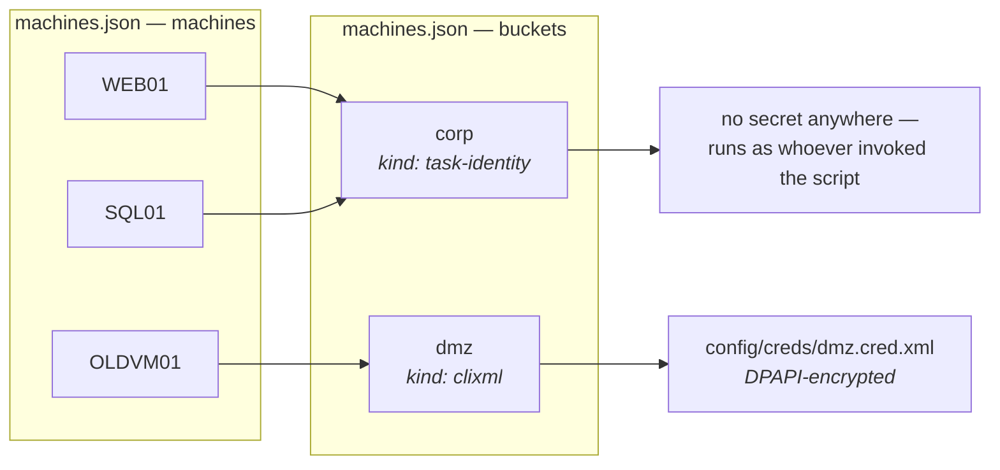
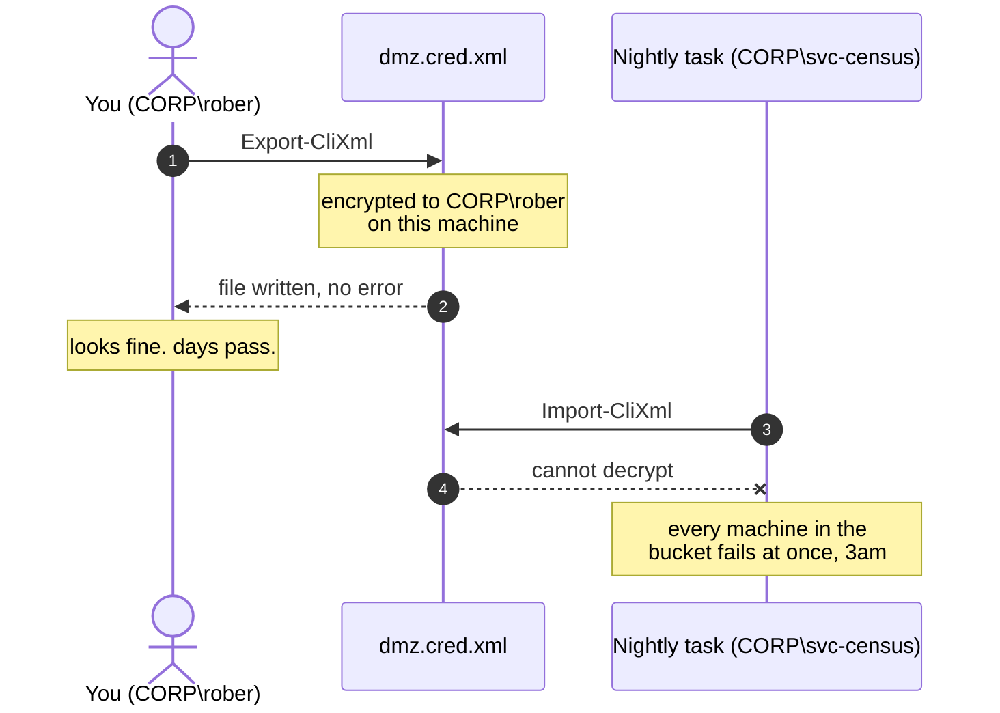
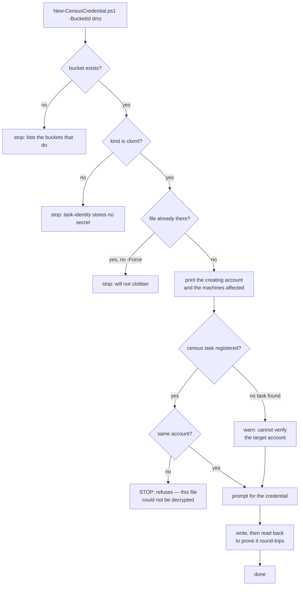
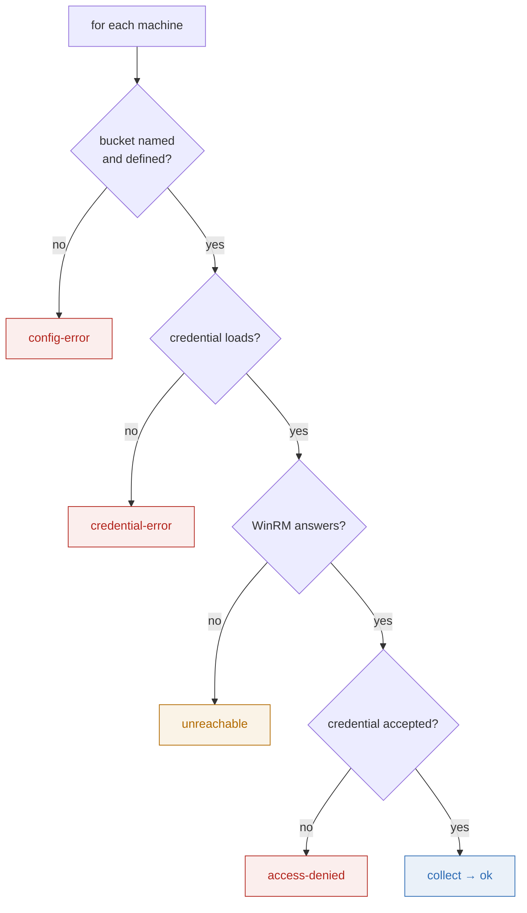

# Census credentials — how they work and how to set them up

> **Who this is for:** whoever has to make the census reach a machine it currently cannot.
> The *design* and its rationale are in `.docs/features/census-collector.md` §5.2–5.2.2; this
> file is the procedure.
>
> **Setting up several buckets in one sitting?** `credential-setup-runbook.html` in this folder
> is the same material as a step-by-step walkthrough, worked through for five buckets with five
> different stored credentials. Open it in a browser. This file stays the reference.

---

## 1. The model in one picture

A machine never carries a credential. It carries a **pointer** to one.



**Why the indirection:** when a password rotates you change **one bucket**, not every machine
that uses it.

**Per-machine credentials are just a bucket of one.** There is no second mechanism — which is
the whole reason buckets were chosen over a credential field on each machine.

---

## 2. Two rules that catch people out

### Every machine must name a bucket. There is no implicit default.

A machine with no `bucket` is a **`config-error`**, not a silent fallback. A default would mean
a machine gets collected under an identity nobody chose, invisibly.

What you *mean* by "the default" is **a bucket most machines point at** — by convention `corp`.
That is a naming convention, not a special case in the code.

### `task-identity` means no credential exists at all

It does not mean "an empty credential". No `-Credential` argument is passed, so the call runs
as whoever invoked the script — you at a prompt, or the scheduled task's account. Nothing is
stored, so nothing can be stolen or go stale.

| Kind | What happens | Secret on disk |
|---|---|---|
| `task-identity` | No `-Credential` argument at all | none |
| `clixml` | Reads a DPAPI-encrypted `PSCredential` from a file | one file per bucket |

---

## 3. The trap worth understanding before you start

`Export-CliXml` encrypts with **DPAPI**, which binds the blob to the **user account** *and* the
**machine** that wrote it.

There is no way to look at a `.cred.xml` and see who can open it. So a file created by the
wrong account looks perfect, reports no error, and fails later — unattended, across every
machine in that bucket at once.



**The fix is simply to create the file as the account the census runs as**, on the control box.

---

## 4. Registering the scheduled task

The task is registered **before** any credential file is created, and the order is not
cosmetic. `New-CensusCredential.ps1` catches a wrong creating account by comparing it against
the account the census task runs as — and it can only do that if there is a task to read. With
none registered it drops to a warning, which is a failure notice arriving hours before anyone
is in a position to act on it.

```powershell
$action = New-ScheduledTaskAction -Execute 'powershell.exe' `
  -Argument '-NoProfile -ExecutionPolicy Bypass -File "C:\github\ai\census\Invoke-Census.ps1"' `
  -WorkingDirectory 'C:\github\ai\census'

$trigger = New-ScheduledTaskTrigger -Daily -At 2:00am

$settings = New-ScheduledTaskSettingsSet -StartWhenAvailable `
  -ExecutionTimeLimit (New-TimeSpan -Hours 4)

Register-ScheduledTask -TaskName 'Census' `
  -Action $action -Trigger $trigger -Settings $settings `
  -User 'CORP\svc-census' -Password (Read-Host 'svc-census password') `
  -RunLevel Highest
```

Through the Task Scheduler UI the equivalent settings are *Run whether user is logged on or
not*, *Run with highest privileges*, and *Start in* set to the repo root. `Invoke-Census.ps1`
takes `-MachinesPath` and `-CensusRoot`, but both default relative to the script, so with
*Start in* correct neither is needed on the command line.

The account needs **log on as a batch job** on the control box and write access to the repo
folder and `output\`. It needs nothing on the target machines — for a `clixml` bucket that is
the stored credential's job, and for `task-identity` it is this same account that must hold
local administrator rights on the targets.

Confirm what the task will actually run as. This string is what §5 step 3 compares against:

```powershell
Get-ScheduledTask -TaskName 'Census' | Select-Object TaskName, @{n='RunsAs';e={$_.Principal.UserId}}
```

### Two ways the account check goes quiet

**Do not run the task as `SYSTEM` if any bucket is `clixml`.** There is no practical way to
reach a shell as `SYSTEM` to create the files, so they end up written as a human account and
fail to decrypt — and `New-CensusCredential.ps1` deliberately skips its mismatch check when the
task account is `SYSTEM` or `S-1-5-18`, so the guard rail that would have caught it says
nothing. `task-identity` buckets under `SYSTEM` are a different question and store no secret,
but a machine account rarely has rights on other machines.

**The check compares short names only** — the part after the backslash. `CORP\svc-census` and
`OTHERDOM\svc-census` pass it and then fail to decrypt. Where more than one domain is in play
on the control box, verify the full string yourself.

---

## 5. Setting up a `clixml` bucket

### Step 1 — reach a shell as the census account

```powershell
runas /user:CORP\svc-census powershell.exe
```

> **Check this early.** If policy denies that account interactive logon, `runas` will not work
> and you need `PsExec -u CORP\svc-census -i powershell` instead. This is the constraint most
> likely to force a rethink, so establish it *before* building the rest of the setup around it.

If the census simply runs as **you**, none of this applies — use `task-identity` and stop here.

### Step 2 — declare the bucket in `config/machines.json`

```json
{
  "id": "dmz",
  "description": "DMZ web tier, separate forest",
  "credential": { "kind": "clixml", "path": "config\\creds\\dmz.cred.xml" },
  "trustedHosts": ["DMZ-WEB01", "DMZ-WEB02"]
}
```

`path` is relative to `Invoke-Census.ps1`. `config/creds/` is already git-ignored.

### Step 3 — create the file

```powershell
.\New-CensusCredential.ps1 -BucketId dmz
```

The helper exists for the checks the two-command version cannot do:



Doing it by hand is fine too — the helper is a guard rail, not a requirement:

```powershell
Get-Credential | Export-CliXml -Path C:\github\ai\census\config\creds\dmz.cred.xml
```

### Step 4 — `trustedHosts`, if the target is workgroup or another forest

Those targets fall back from Kerberos to NTLM, which requires them listed in `TrustedHosts`
**on the control box**. The census **reports** a missing entry and stamps the affected
machines. **It never writes the setting** — silently changing a security setting to make its
own job succeed is not something this tool does. Add it yourself:

```powershell
Set-Item WSMan:\localhost\Client\TrustedHosts -Value 'DMZ-WEB01,DMZ-WEB02' -Concatenate
```

---

## 6. Verifying before you trust the nightly run

```powershell
.\Invoke-Census.ps1 -CensusRoot C:\temp\census-test -Verbose
Get-Content C:\temp\census-test\_runs\run-log.jsonl | ForEach-Object { $_ | ConvertFrom-Json } |
    Format-Table machine, bucket, outcome, reason
```



| Outcome | What it means | What to do |
|---|---|---|
| `ok` | Collected | — |
| `config-error` | A machine names a bucket that is not defined, or names none | Fix `machines.json` |
| `credential-error` | The file is missing, **or was created by the wrong account** | The reason names the account it tried as. Re-create it as that account. |
| `access-denied` | WinRM answered and **refused** the credential | Real but wrong, or stale after a rotation |
| `unreachable` | WinRM never answered | Nothing to do with credentials — DNS, routing, or the service is not running |

> **`access-denied` and `unreachable` are deliberately separate.** A rotated service-account
> password would otherwise read as a network outage, which sends you debugging the wrong thing.

---

## 7. Rotating a password

1. Reach a shell as the census account (§5 step 1).
2. `.\New-CensusCredential.ps1 -BucketId dmz -Force`
3. Verify with §6.

Every machine in the bucket picks it up on the next run. Nothing else changes — which is what
the bucket indirection bought.

---

## 8. What is *not* proven

**No remote WinRM call carrying a `-Credential` has ever been exercised.** The development
environment has one machine and one account, so bucket resolution, DPAPI round-tripping, the
outcome classifier and the `context` block are all tested, but the actual credentialed hop is
not. Treat the first real run against a `clixml` bucket as the test, and run it interactively
with `-Verbose` before trusting it to a schedule.
